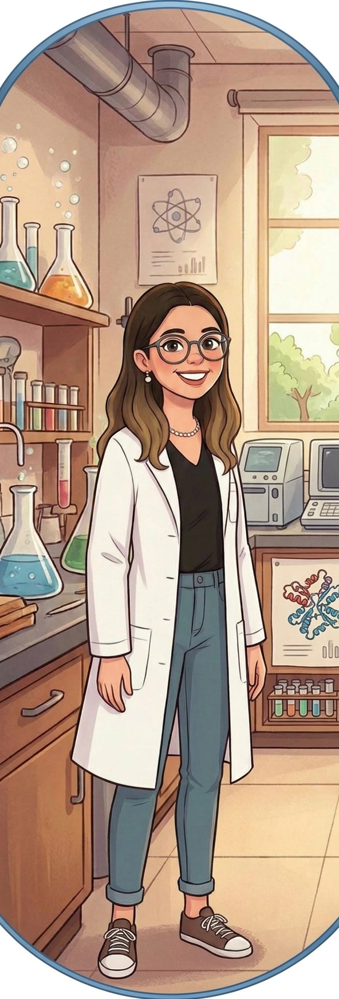
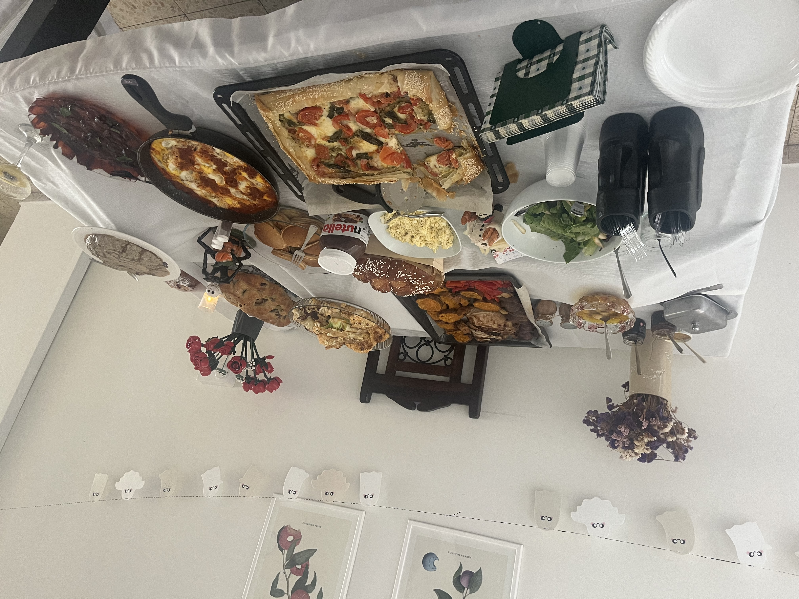

  
  <h1 style="margin: 0; border-bottom: none;">Keren Eden</h1>

### PhD Student in Molecular Biology
**Weizmann Institute of Science** | Department of Molecular Genetics  
🧪 **Laboratory:** [Laufman Lab Website](https://www.weizmann.ac.il/molgen/Laufman/)

---

## 🔬 About My Research

I am a PhD student in Molecular Biology at the Weizmann Institute of Science, working in **Dr. Orly Laufman’s lab**. 

Our laboratory investigates how positive-strand RNA viruses replicate within host cells, using enteroviruses as primary model pathogens. My specific doctoral research focuses on uncovering novel regulatory mechanisms that link **extracellular matrix homeostasis** with cellular **antiviral defense mechanisms**.

---

## 💻 Why Python & AI

Biological research generates increasingly complex datasets. Handling large-scale biological data manually in tools like Excel is time-consuming and prone to human error. 

Through this course, I am developing workflows to:
- Automate data processing and analysis.
- Extract and integrate data efficiently from external biological databases.
- Build reproducible data pipelines for viral genomics and cell biology research.

---

## 🥐 Personal Interests 

When I’m not in the lab, you’ll usually find me in the kitchen! I love baking (especially sourdough baguettes and yeast pastries), hosting big multi-course dinners for friends, and getting lost in a good book.

---

© 2026 Keren Eden | Built with GitHub Pages
